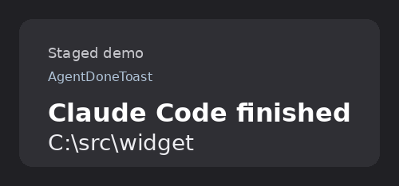

# agent-done-toast

On Windows 10 and Windows 11, agent-done-toast shows you a toast when Claude Code, OpenAI Codex CLI, or Cursor CLI finishes or waits.

## Quick start

1. Clone the repo: `git clone https://github.com/kamilkaczmareksolutions/agent-done-toast` and `cd agent-done-toast`.
2. Run `powershell.exe -NoProfile -ExecutionPolicy Bypass -File .\install.ps1`.
3. Finish a Claude Code turn. You see the title `Claude Code finished` and the project directory as the body.

To remove the hooks, run `powershell.exe -NoProfile -ExecutionPolicy Bypass -File .\uninstall.ps1`.

## Examples

The body is the project directory. A blank directory uses `No project path`.

| Event | Title |
| --- | --- |
| Claude Code finishes a turn | `Claude Code finished` |
| Claude Code asks for permission or input | `Claude Code needs you` |
| Codex finishes a turn | `Codex finished` |
| Codex asks for permission | `Codex needs you` |
| Cursor finishes a turn with status completed | `Cursor finished` |

## Limitations

Cursor has no needs-input hook. A foreign Codex notify command is left in place. WSL is not installed by this script. Aborted or error Cursor stops stay silent.

The script writes user config files and does not write project configs. Clicking the toast launches nothing, and the agent gets no reply. A Claude stop stays silent when `stop_hook_active` is true. When Codex already has a different notify command, install still wires Claude and Cursor, then exits 2.

## License

This project is MIT licensed. See `LICENSE`.
